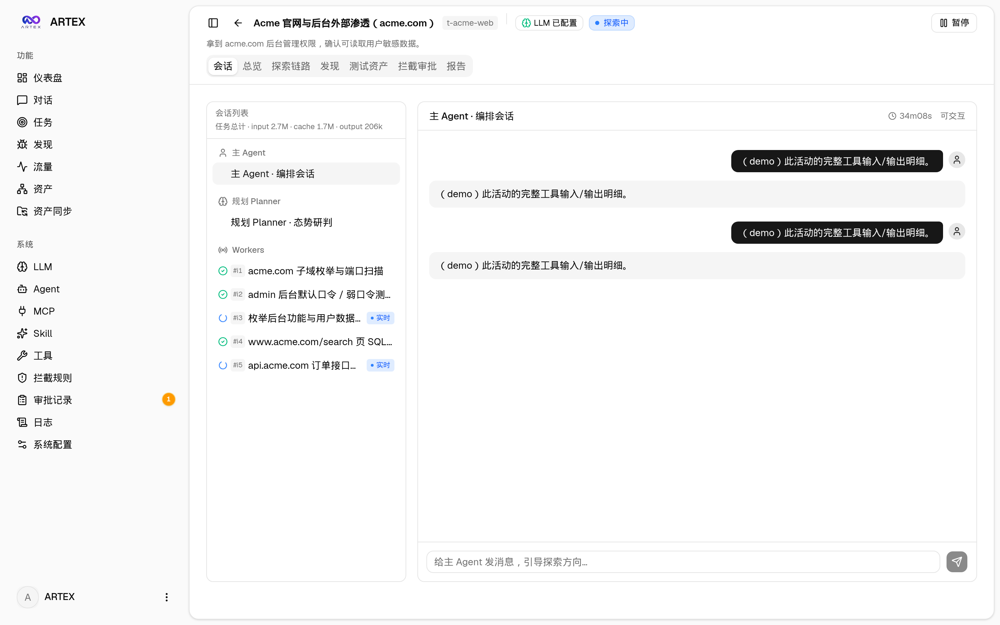
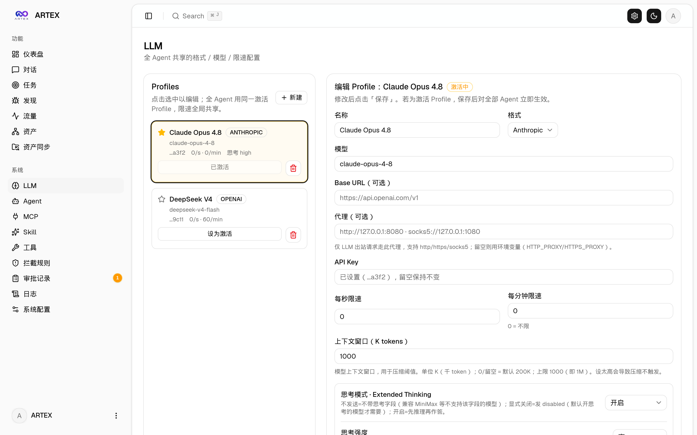
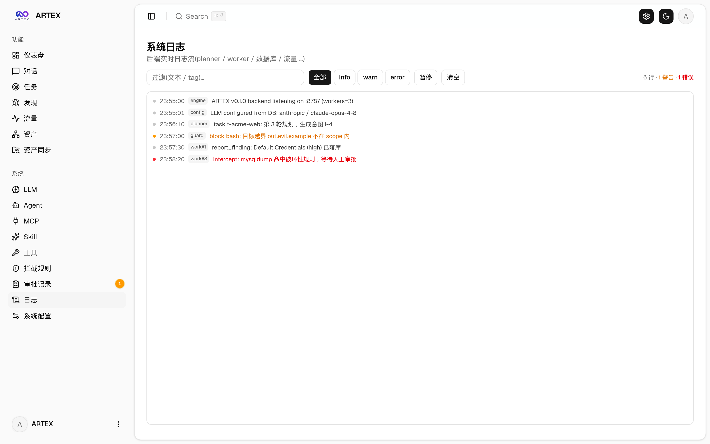
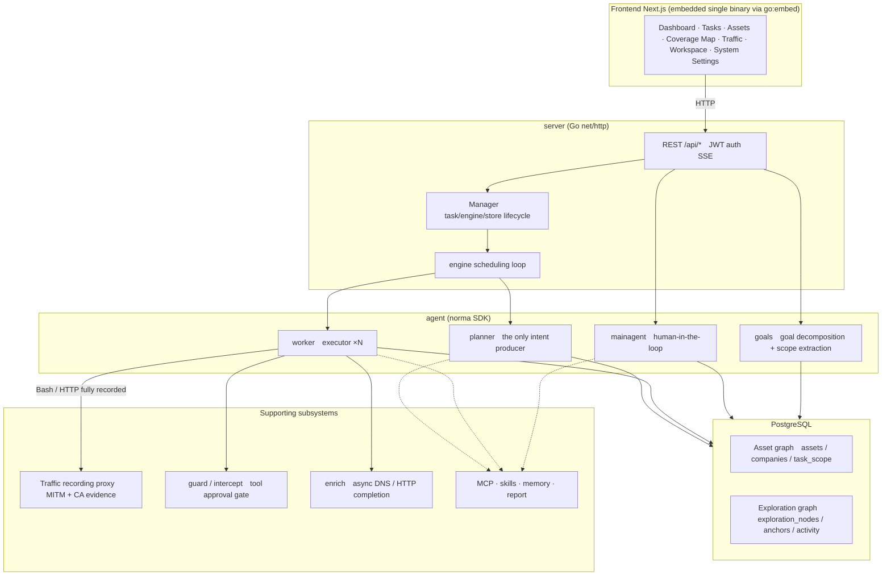
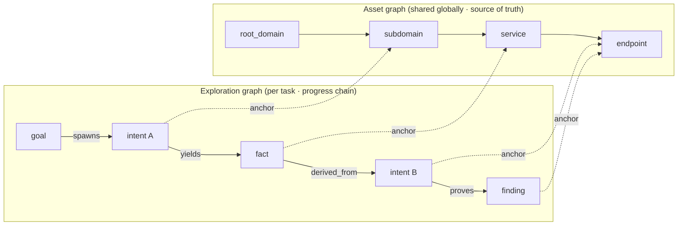
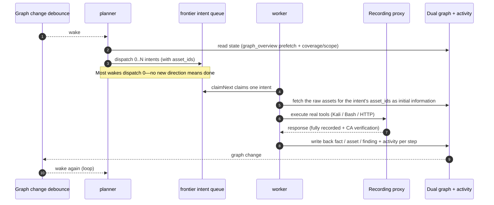
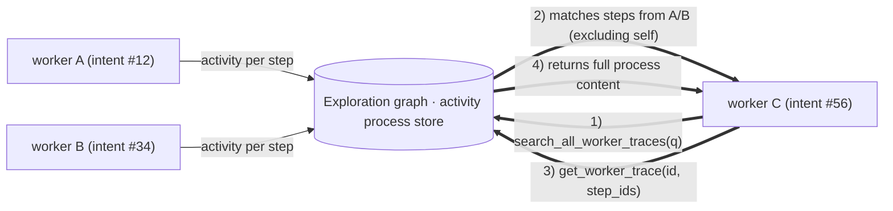
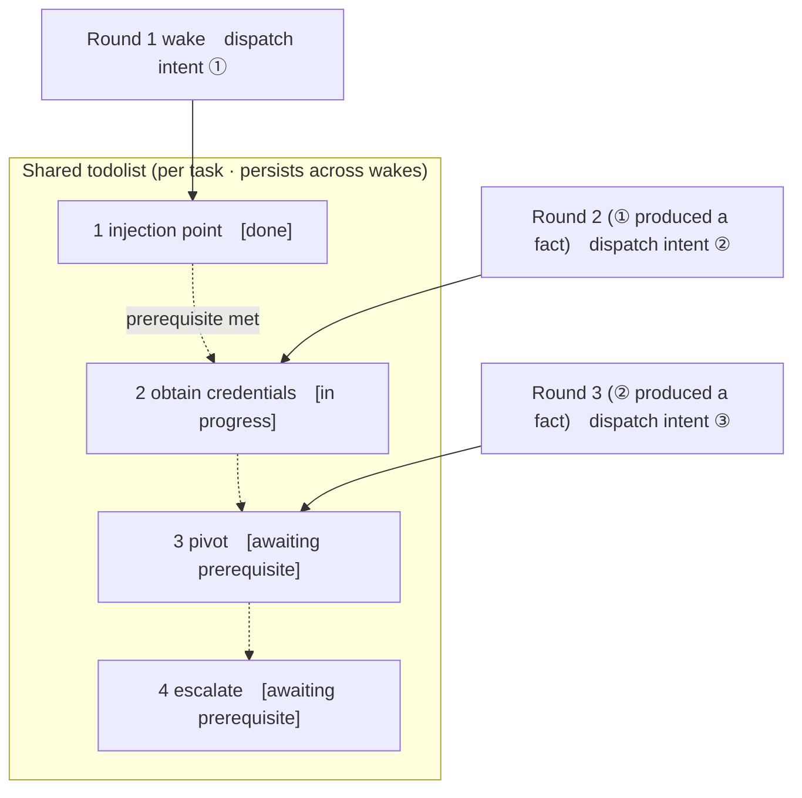

<div align="center">

# ARTEX

> **Archived upstream README.** This describes the upstream project and its
> prebuilt-image deployment. Do not follow its Docker or installer instructions
> in this fork. Use [`README.md`](README.md) instead.

Autonomous AI penetration testing system (Go backend + Next.js frontend)


🌐 **Online Demo**: [https://artex-demo.vercel.app/](https://artex-demo.vercel.app/)

</div>

This repository is an independently maintained fork of [RuoJi6/ARTEX](https://github.com/RuoJi6/ARTEX), retaining ARTEX's original commit history and AGPL-3.0 license. Release packages are downloaded from this repository's Releases, and the Docker image [ruoji6/artex](https://hub.docker.com/r/ruoji6/artex) is built and published by this repository's GitHub Actions.

---

## Screenshots

> See the [online demo](https://artex-demo.vercel.app/) for the full interaction.

| Dashboard (Overview / Token Usage / Activity Stream) | Tasks |
| :---: | :---: |
|  |  |

| Task · Execution (Sessions / Tool Calls) | Exploration Graph |
| :---: | :---: |
|  |  |

| Findings | Assets |
| :---: | :---: |
|  |  |

| Asset Coverage Map (force-directed layout · tested nodes highlighted · collapsible nodes) |
| :---: |
|  |

| Traffic Recording | Human-in-the-loop Chat |
| :---: | :---: |
|  |  |

| Agents | LLM |
| :---: | :---: |
|  |  |

| Intercept Approvals | Backend Logs |
| :---: | :---: |
|  |  |


---

## Approval record details

The global "Approval Records" page, a task's "Intercept Approvals" tab, and approval cards in conversations can all be expanded to view details. The presentation follows
[AegisHook's approval detail component](https://github.com/RuoJi6/AegisHook/blob/main/web/src/components/CallDetail.vue), using ARTEX's components and theme:


## Asset sync (ScopeSentry)

Supports syncing asset data directly from [ScopeSentry](https://github.com/Autumn-27/ScopeSentry), avoiding duplicate collection:

- On the "**Asset Sync**" page, enter ScopeSentry's address and API Key to connect the data source;
- Select the targets and asset types to sync by **project** or **task** (domain / subdomain / IP / port / site / endpoint…);
- Import in one click and merge by company asset scope, feeding directly into ARTEX's asset graph for the agent to explore.

---

## Installation

> Depends on a **PostgreSQL** database; exploration requires an **LLM** (`ANTHROPIC_API_KEY` or `OPENAI_API_KEY`, which can also be configured in the UI).

### Option 1: One-click install script (recommended)

```bash
git clone https://github.com/RuoJi6/ARTEX.git
cd ARTEX
./install.sh
```

The script will: detect / automatically install Docker → let you choose **① all Docker** or **② local build and run**:

- **① All Docker**: enter a Postgres password (press Enter for a random one) → automatically write `.env` → `docker compose up -d`.
- **② Local run**: choose a database (use an existing one / start one with Docker) → generate `config.json` → compile the embedded single binary with `go` → start.

After installation, open **http://localhost:8787** (on first visit, `/setup` asks you to set the administrator password).

### Option 2: Docker Compose (manual)

```bash
git clone https://github.com/RuoJi6/ARTEX.git
cd ARTEX
cp .env.example .env          # fill in POSTGRES_PASSWORD, optionally ANTHROPIC_API_KEY
docker compose up -d          # pull the ruoji6/artex image + postgres
# → http://localhost:8787
```

The image already includes common tools (ripgrep/curl/vim/npm/nmap…); `./skills` and `./data` are persisted via bind mounts.

In `.env`, the defaults are `ARTEX_IMAGE=ruoji6/artex` and `ARTEX_TAG=latest` for the latest image; you can also pin `v0.3.15` (the full image reference is `ruoji6/artex:v0.3.15`). The image supports `linux/amd64` and `linux/arm64`; Docker automatically picks the architecture matching the host, so ARM64 Kali needs no local build. Change `POSTGRES_PASSWORD` on first deployment; no Docker Hub publishing token is needed to run the service.

Remote MCP can use `http` (Streamable HTTP) or `sse` (legacy SSE) in System Settings.
Legacy SSE services typically use `GET /sse` to establish the event stream, then receive JSON-RPC requests through the
`/message?sessionId=...` returned by the service; when configuring, fill in the URL as `/sse` and the request header as
`Authorization=Bearer <token>`.

### Option 3: Download a prebuilt binary (Releases)

Go to this repository's [Releases](https://github.com/RuoJi6/ARTEX/releases), download the zip for your platform, and extract it to get `artex` + `start.sh` (Windows: `start.bat`) + `skills/` + `config.example.json`. For Linux ARM64 (including ARM64 Kali) choose `linux-arm64`; for x86_64 choose `linux-amd64`:

```bash
cp config.example.json config.json   # fill in the database connection
./start.sh                           # → http://localhost:8787
```

> Start with `start.sh` / `start.bat`, not by running `./artex` directly. It is a supervisor script: after the program exits, it decides from the exit code whether to relaunch, and **the [one-click update](#option-1-one-click-update-in-the-ui-recommended) in the UI relies on it to perform the swap**. If you run `./artex` directly, it will not be relaunched after an update.
> To keep it running in the background: `nohup ./start.sh >artex.log 2>&1 &`.

### Option 4: Build a single binary from source

```bash
# 1) Export the frontend static build
cd web && npm ci && npm run build:static && cd ..
# 2) Copy it into the embedded directory
cp -r web/out server/webui/dist
# 3) Build (only -tags embedui embeds the frontend)
CGO_ENABLED=0 go build -tags embedui -o artex ./cmd/artex
./start.sh
```

### Option 5: Build cross-platform release archives

`build.sh` first builds and embeds the frontend, then uses the Go linker to strip debug information and compresses the release files into zips. Release mode by default produces zips for Linux amd64/arm64, macOS amd64/arm64, and Windows amd64:

```bash
./build.sh --release
# Output: dist/artex-0.3.3-*.zip
```

UPX self-extracting binaries may be incompatible with some Linux kernels, virtualization environments, or security policies, so UPX is disabled by default. Use `ARTEX_TARGETS` to customize targets; when you have confirmed that the target runtime is compatible, pass `--upx` explicitly to shrink the binary further:

```bash
ARTEX_TARGETS=linux/amd64,windows/amd64 ./build.sh --release
./build.sh --target linux/amd64 --upx
```

---

## Updating

> Upgrades replace only the program, not the data: the Postgres data volume `pgdata`, `./data` (jwt.key / SQLite, etc.), and `./skills` are all preserved. **Database migrations need no manual step**—`artex` idempotently reruns `schema.sql` on every startup (including `ADD COLUMN` / `CREATE INDEX IF NOT EXISTS`), so "restart is migration". It is still advisable to back up `./data` and the database before upgrading.

### Option 1: One-click update in the UI (recommended)

On the **System Settings** page (sidebar "System Settings" → `/system/settings`), the **Version & Updates** card lets you check for and install a new version directly, without logging in to the server.

Builds from this repository always check for updates from the latest stable GitHub Release of `RuoJi6/ARTEX`, skipping drafts and pre-releases. Older official builds still point at the original author's repository, so the first switch must be done by manually installing a build from this repository; after that, publishing a higher three-part version enables in-page upgrades. Pushing to main or creating a Git tag without publishing a Release does not produce an installable online update.

After clicking "Update": download the release package for the current platform → compare against the Release's `SHA256SUMS` → smoke test the new binary with `-h` → stage it as `artex.new` → the program exits, and `start.sh` / `start.bat` relaunches it to complete the swap. The page waits automatically for the new version to come online before refreshing.

- **Failures leave no broken program**: if verification or the smoke test fails, the staged file is discarded and the current version keeps running; if the swapped-in new version fails to start 3 times in a row, it automatically rolls back to `artex.old` (the failed one is kept as `artex.failed` for troubleshooting).
- **You can roll back at any time**: the previous version is kept as `artex.old`, and the card has "Roll back to previous version". Note that the database schema does not roll back.
- **Updating interrupts running tasks**—an update is a restart, so do it while idle.
- **Development builds are not offered updates**: disabled when the version is `dev` or `git describe` has a suffix, to avoid a stable release overwriting a local debug binary.
- **Under Docker only the program is replaced, not the image**: toolchains such as playwright / nmap in the image do not upgrade with it, and recreating the container with `docker compose up -d` reverts to the image's bundled version. To upgrade the image too, still use `docker compose pull artex && docker compose up -d artex`.
- If accessing GitHub requires a proxy, configure the **global proxy** on the same page; the update path uses it. Updates download only from GitHub domains and enforce HTTPS.

### Maintainers: publishing online updates via GitHub Actions

The release workflow is `.github/workflows/release.yml`. Pushing a stable tag triggers a build; you can also go to Actions → release → Run workflow and enter an existing tag to rerun a failed release. Tags must be `v<major>.<minor>.<patch>`, such as `v0.3.15` in the example below; later versions must be higher than the version users are running.

```bash
git push origin main
git tag v0.3.15
git push origin v0.3.15
```

The workflow pins the commit corresponding to the tag, exports the frontend with Node.js 22, builds the five-platform binaries with the embedded frontend using the Go version specified by `go.mod`, and generates ZIPs and `SHA256SUMS`. AMD64 and ARM64 images are built on GitHub's native runners; a temporary PostgreSQL verifies program startup, version, and embedded frontend; once both architectures pass, the multi-architecture image's version tag and `latest` are published. After the image is published successfully, the full ZIPs and checksum files are uploaded, and finally the Release is made public. An already-public version cannot be overwritten; publish a new tag instead.

Maintainers must configure the variable `ARTEX_DOCKER_IMAGE` (Docker Hub username/image name) and the secrets `DOCKERHUB_USERNAME` and `DOCKERHUB_TOKEN` (with image push permission) in this repository's Settings → Secrets and variables → Actions. Program packages are uploaded via GitHub's built-in `GITHUB_TOKEN`, while images are pushed to Docker Hub with the credentials above. Credentials are used only for workflow login and are not written into source or images. The image address is also recorded in `.env.example` and the Compose defaults.

### Migrating an existing Docker deployment to this repository's image

In the original deployment directory, back up `.env`, the Compose file, `data/`, and the PostgreSQL data, keeping the original database volume and skills mount. Set `.env`'s `ARTEX_IMAGE` to this repository's image address and `ARTEX_TAG` to the target version; if the old Compose file still hardcodes the original author's image, create the following override file (merge the image configuration if an override file already exists):

```yaml
# docker-compose.override.yml
services:
  artex:
    image: ${ARTEX_IMAGE}:${ARTEX_TAG:-latest}
```

Then update only the application container:

```bash
docker compose pull artex
docker compose up -d --no-deps artex
curl --fail http://127.0.0.1:8787/api/health
docker compose logs --tail=50 artex
```

Continue using the original deployment directory and Compose project name, ensuring `./data`, `./skills`, and the PostgreSQL data volume still point at the original data. After migration the program checks for online updates from `RuoJi6/ARTEX`; subsequent updates can use the in-page updater or the commands above to update the entire image.

When migrating an existing Docker deployment for the first time, extract the verified new ARM64 ZIP on the host, back up the original program, and then replace only `/app/artex` in the existing container. For example, if the existing container is named `artex-artex-1`:

```bash
# Run in the download directory; first verify the downloaded ZIP against SHA256SUMS, then extract.
sha256sum --ignore-missing --check SHA256SUMS
unzip artex-0.3.15-linux-arm64.zip
sudo docker stop artex-artex-1
sudo docker cp artex-artex-1:/app/artex ./artex-before-migration
sudo docker cp ./artex-0.3.15-linux-arm64/artex artex-artex-1:/app/artex
sudo docker start artex-artex-1
curl --fail http://127.0.0.1:8787/api/health
```

This preserves the existing database, data, and skills mounts. Log in to the System Settings page to check the update source and version. The replaced program inside the container still belongs to the container's writable layer; deleting or recreating the container loses the replacement. When a rebuild is needed, use an image that contains this repository's program. Program rollback does not roll back database migrations, so back up the database and data before upgrading.

### Option 2: One-click update script

```bash
cd ARTEX
./update.sh
```

The script first optionally runs `git pull` for the latest code, then lets you choose **① Docker update** or **② local build update** (corresponding to `install.sh`):

- **① Docker**: optionally specify the target image tag (press Enter to reuse `.env`'s `ARTEX_TAG`, defaulting to `latest`) → `docker compose pull` → `docker compose up -d` (a new image restarts and migrates automatically).
- **② Local**: rebuild the frontend static output → recompile `./artex` (restart the process to take effect).

### Option 3: Docker Compose (manual)

```bash
cd ARTEX
git pull                       # update compose / scripts (optional)
# Pin a version: set ARTEX_TAG=v0.3.15 in .env; otherwise latest is used
docker compose pull artex
docker compose up -d artex     # new image restarts → schema migration is automatic
docker image prune -f          # clean up old images (optional)
```

### Option 4: Prebuilt binary (Releases)

Go to [Releases](https://github.com/RuoJi6/ARTEX/releases), download the new version's zip, stop the old process, overwrite `artex` and `skills/` (keeping your `config.json` and `data/`), and restart:

```bash
cp -r <extract-dir>/skills ./ && cp <extract-dir>/artex ./
./start.sh
```

### Option 5: Build from source

```bash
git pull
cd web && npm ci && npm run build:static && cd ..
cp -r web/out server/webui/dist
CGO_ENABLED=0 go build -tags embedui -o artex ./cmd/artex
# Restart ./start.sh
```

---

## Configuration

**Database** (`config.json`, or override with the `ARTEX_PG_DSN` environment variable):

```json
{
  "database": {
    "host": "127.0.0.1", "port": 5432,
    "user": "artex", "password": "yourpass",
    "dbname": "artex", "sslmode": "disable"
  }
}
```

**LLM**: `export ANTHROPIC_API_KEY=sk-...` (or `OPENAI_API_KEY`); you can also fill it in on the UI's "LLM" page.
Optional: `ARTEX_LLM_PROVIDER` / `ARTEX_LLM_MODEL` / `ARTEX_LLM_BASE_URL` / `ARTEX_LLM_PROXY`.

**Concurrency**: the number of work agents per task is configured in "System Settings" (default 3).

**Common arguments**: `./start.sh -addr :8787 -proxy :8788` (`-addr` frontend + API, `-proxy` traffic recording proxy). The startup script passes arguments through to `artex` unchanged.

### Reverse-proxy deployment (HTTPS / expose only 443)

The frontend and API/SSE are both served by the same backend port (default `:8787`), and the live activity stream defaults to the **same-origin** address, so **no `NEXT_PUBLIC_SSE_BASE` is needed**; expose only 443 publicly and keep 8787 on the internal network.

SSE is a long-lived connection with continuous pushes, so the reverse proxy **must disable buffering**; otherwise the browser can connect but receives no events (the activity stream spins forever). Nginx example:

```nginx
server {
    listen 443 ssl;
    server_name your.domain.com;
    # ssl_certificate / ssl_certificate_key ...

    location / {
        proxy_pass http://127.0.0.1:8787;
        proxy_set_header Host $host;
        proxy_set_header X-Forwarded-Proto $scheme;

        # Key SSE settings: disable buffering, long timeout, HTTP/1.1
        proxy_buffering off;
        proxy_cache off;
        proxy_read_timeout 3600s;
        proxy_http_version 1.1;
        proxy_set_header Connection "";
    }
}
```

> Only when SSE needs to come from a different origin than the page (such as a dedicated subdomain) should you set `NEXT_PUBLIC_SSE_BASE` at **build time** (the variable is fixed into the static bundle during `next build`; setting it at container runtime has no effect).

---


## Development

### Manual vulnerability retest

The "Retest" tab in task details lets you page through the task's findings, view each conclusion and evidence, and start a manual retest. After starting, the current tab is kept and a spinner plus "Retesting" is shown; once a fix is confirmed, the finding status is updated.

Click "Retest" in each row's action area of the findings list, or "Start retest" in the "Vulnerability Retest" area of a finding detail, and fill in the optional fixed version and test conditions or limitations. The system creates an independent retest Agent session and keeps the current page after starting. This entry point is available in the flat list, by-task grouping, and asset views; while a retest runs, a spinner and "Retesting" are shown, and clicking enters the corresponding session; when it finishes, the "Retest" action is restored. Retesting does not require restarting the original scan task; conclusions are "Still reproducible", "Fixed", or "Unable to confirm", and each conclusion, evidence, and session link is saved in the finding detail.

On first startup, a new backend seeds an editable "Vulnerability Retest" (`retester`) Agent, whose prompt, LLM, run budget, and tools can be configured in Agents. It uses its bound LLM by default, or the globally active configuration if none is bound. When a retest session completes successfully with the conclusion "Fixed", the system automatically changes the finding's disposition status to "Fixed"; running, failed, stopped, or other conclusions keep the original status. Original evidence and reports are always retained. You can also manually select "Fixed" in the status dropdown. If the same finding is already being retested, the existing session is reused; after stopping, failure, or a service restart, a retest can be started again.

In this version, history is viewed through finding details and sessions; it is not yet included in finding report exports or task archive packages, nor automatically linked to traffic packets. Demo mode generates only clearly labeled simulated records and does not contact real targets.

### Local run and tests

```bash
./dev.sh    # backend (:8787) + traffic proxy (:8788) + frontend next dev (:5173) → http://localhost:5173
```

- Backend: `go run ./cmd/artex` (without `-tags embedui`, the frontend is not embedded)
- Frontend: `cd web && npm run dev` (`/api` is proxied to the backend, with hot reload)
- Tests: `go test ./...`
- Mock preview (no backend): `cd web && NEXT_PUBLIC_MOCK=1 npm run dev`

---

## System architecture

ARTEX is an **LLM multi-agent-driven autonomous penetration system**: a Go monolith backend (with the Next.js frontend embedded) + PostgreSQL, with agent capabilities provided by the [`norma`](https://github.com/Autumn-27/norma) SDK (`agentcore` / `tool` / `permission` / `harness` / `memory` / `transcript`). At its core is a **dual-graph architecture**, plus two autonomy mechanisms around it: **process-level information exchange between workers** and a **planner shared multi-round todolist that stabilizes the attack chain**.

### Overall layering



| Layer | Responsibility |
| --- | --- |
| **Frontend** | Next.js static export, embedded into the single binary via `go:embed`; visualizes tasks/assets/exploration graph/coverage map, human-in-the-loop chat |
| **server** | `net/http` routing + JWT auth + SSE; `Manager` manages the lifecycle of tasks, engines, and the DB store |
| **engine** | One `plannerLoop` + N worker goroutines per task; intent claiming, timeout/pause/drain |
| **agent** | goals / planner / worker / mainagent; `ToolSet` exposes the dual graph as LLM tools |
| **db** | Postgres persistence of the dual graph (pgx); schema is idempotently created on every startup via `go:embed` |
| **support** | Recording MITM proxy, approval gate, async enrichment, MCP/skills/memory/report |

### Dual-graph architecture: exploration graph + asset graph

The system splits "**what the target is**" and "**how far it has been tested**" into two independent graphs connected by anchors:

- **Asset graph (global, shared)**: a single source of truth for assets shared across tasks. Nodes are `root_domain / subdomain / ip / service / app / endpoint`, owned by a company; the parent-child relationships from domain → subdomain → service → endpoint and all deduplication keys are computed by the program, while agents submit only raw information.
- **Exploration graph (per task, independent)**: the "thinking and progress" process of a single task. Nodes are `goal / intent / fact / finding / hint`, connected into **lineage chains** by edges such as `spawns / derived_from / yields / proves`, answering "which direction derived from which facts, and what it produced".
- **The two graphs are connected by anchors**: `exploration_anchors(node_id, asset_id)` anchors intents/facts/findings to specific assets—so you can both see which assets an "exploration direction" targeted, and, from "a given asset", trace which intents tested it in this task and what facts were produced. This also supports **asset test coverage** and the **asset coverage map** (in-scope assets + tested highlighted).



> Division of labor: **planner** reads the exploration graph's state, judges goals, and dispatches **intents** to the frontier only when there are uncovered new directions; **worker** claims **one intent**, executes it with real tools, writes new assets/facts/findings back to both graphs, and stops. The asset graph is shared truth; the exploration graph is each task's progress chain.

### Engine and intent lifecycle (the loop of one exploration)

The engine is an **event-driven** loop: a graph change wakes the planner, the planner dispatches intents, workers claim and execute intents and write back, and the write-back triggers the next round—until the goal is proven (`prove_goal`).



### Process-level information exchange between workers

In a deep exploration, many valuable observations (an error, a response fragment, a hidden parameter) appear during a worker's **execution process** but are not necessarily written as a formal fact. To avoid duplicated work and let workers in the chain stand on each other's shoulders, workers can **search other work's processes across the work**:

- `search_all_worker_traces(q)`: search by keyword in **the execution processes of other work in this task** (automatically excluding steps from the worker's own intent); matches carry an `intent_id`;
- `list_worker_traces` / `get_worker_trace(intent_id, step_ids=[…])`: first see which work has run, then fetch the full content of specific steps of a work for detailed exchange.

So even when the exploration graph has no corresponding fact yet, later workers can reuse observations from others' processes—**information flows between workers at the granularity of "execution process"**, while boundaries stay unchanged (each worker still only handles the intent it claimed).



### Planner shared multi-round todolist → a stable attack chain

Real attack chains are often **multi-step sequences with dependencies** (e.g., find an injection point → obtain credentials → pivot → escalate). Dispatching all of these in parallel at once only causes chaos. The planner therefore keeps a **planning todo list preserved per task and shared across wakes**:

- The planner is event-driven—woken whenever the graph changes, but **each wake is a fresh session**; the shared todolist lets it **record a serial exploitation chain once** and then **dispatch intents step by step by dependency** over subsequent rounds, instead of front-loading the entire chain in one round;
- Each round dispatches an intent only for the next step whose "prerequisites are complete and whose dependent facts exist", and updates the list as progress is made (marking steps satisfied by facts as done).



Thus the attack chain still **advances stably, without duplication or misordering** in an "event-driven + stateless session" environment—this is the key to ARTEX autonomously completing multi-step exploitation chains.

---

## Community

Scan the QR code to follow the WeChat official account **SecSentry**, then send a private message to the account to join the community.

<div align="center">


</div>

---
## References

https://github.com/oritera/Cairn


## License and disclaimer

### Open-source license

This project is licensed under the **GNU Affero General Public License v3.0 (AGPL-3.0)**; the full terms are in the [LICENSE](LICENSE) file at the repository root.

This means anyone may freely use, modify, and distribute the project, but **derivative works must also be open-sourced under AGPL-3.0**; in particular, **if you modify this project and provide it to users over a network (for example, by deploying it as an online service), you must also make the corresponding complete source code available to those users**.

> ⚠️ **Important**: the open-source license itself does not restrict the purposes for which the software may be used. The "usage restrictions" and "disclaimer" below are the author's additional stipulations and solemn statement to users, and must be observed.

**ARTEX is for personal learning, code study, and local technical validation only; it must not be used to conduct actual testing against any online system or website.**

### Permitted use

- Only for **reading, learning, and studying this project's source code**, and for validating technical principles in a **local isolated environment**;
- Suitable for non-offensive purposes such as personal learning, academic research, and code review.

### Prohibitions

- **It is strictly forbidden to use this tool to scan, probe, exploit, or attack any website, online service, or networked system** (whether or not authorized, and whether or not it is your own asset);
- It is strictly forbidden to use this tool for any actual penetration testing, red-team/blue-team exercises, or production environments;
- It is strictly forbidden to use this tool for illegal intrusion, data theft, extortion, denial of service, or any destructive or criminal activity;
- It is strictly forbidden to use this tool to engage in any conduct that violates the laws and regulations of your country/region.

### Compliance responsibility

Users must comply with all laws and regulations of their country/region concerning cybersecurity, data protection, and computer crime (in mainland China, including but not limited to the Cybersecurity Law, Data Security Law, Personal Information Protection Law, and related judicial interpretations). **All legal liability and consequences arising from the use of this tool are borne solely by the user.**

### Disclaimer

This project is provided "AS IS" without any express or implied warranty. The author and contributors are not liable for any direct or indirect loss, data loss, system damage, or legal dispute caused by using this tool (whether or not used properly). **By downloading, installing, or using this project, you acknowledge that you have read, understood, and agreed to all the terms above.**
