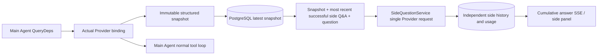

# ARTEX `/btw`

Ordinary chat, a task's MainAgent, and the current task's own Workers support independent side questions. Type `/btw question` in the main input box to submit one; an empty `/btw` or the "Side question" button opens the history. The desktop layout uses a resizable side panel, and mobile uses a Drawer.

A side answer is generated from the Agent context snapshot captured at submission time, and supports streaming display, follow-ups, stop, and clear. Closing the panel, refreshing the page, or dropping the SSE connection does not cancel the model request. Stop affects only the current side question; Clear cancels the side question and deletes its history while keeping the main context snapshot.

## Implementation boundaries

Uses Go, norma v0.3.7, Next.js, and the existing Markdown / ResizablePanel / Drawer / AlertDialog components; no norma source was modified and no dependency was added for side questions. Planner, Workers inherited from other tasks, and upgrades of tool-type subtasks are out of scope.

- `capture.go` marks only requests from the main loop via `Options.Deps.CallModel / CallModelSync`. The Provider decorator sits inside the concrete model, after the routing pool has selected a member, so it records the model actually chosen; compaction and summary requests do not overwrite the snapshot.
- Snapshots are published at request start, on a complete model reply, and at a terminal run state. A partially generated reply is not published; tool calls stay paired through norma's `MessagesForAPI`, and tool results enter the snapshot on the next main model request or at the terminal run state. A streaming abort keeps the last valid boundary.
- The snapshot keeps structured messages, the system prompt, tool definitions, and generation parameters via a JSON deep copy. Model inference holds neither the snapshot lock nor a database transaction.
- `SideQuestionService` calls the concrete Provider; if needed it first generates a side summary, and the final answer may be retried once after shrinking only when the context is first exceeded and no text/tool call has been emitted yet. It creates no agent session, connects to no tool executor, main transcript, activity stream, or task graph, and bypasses the task model-switch chain. Answers keep tool definitions for compatibility with existing structured tool context; summary requests are given no tools. Any newly returned tool calls have no execution path.
- One running request per parent session, at most four per service process, and a 120-second timeout per request. Side questions use an independent cancellation context under the service lifecycle.
- Side requests keep the model configuration reference and a non-sensitive identity digest; credentials are read from the existing configuration at request time. If the configuration is deleted, or identity fields such as model, protocol, or address change, the main Agent must run first to refresh the snapshot. Tests do not change the product's default model.

## Persistence and recovery

`db/schema.sql` creates `side_question_sessions` and `side_question_requests` automatically. The former stores the parent resource, latest snapshot, run number, version, and clear version; the latter stores the question, cumulative answer, status, model, snapshot time, usage, event sequence, and paging sequence.

The parent-session key uses the conversation ID, or task ID + exploration ID + intent ID. Workers do not use reusable execution-slot names.

Snapshots are merged per parent session and flushed every 250 ms; the database compares `(run_id, version)` to prevent an older version from overwriting a newer one. The selected snapshot is saved again before a side question is submitted. After a successful save the large in-memory snapshot is released; on failure the version remains pending. Cumulative answer content is written at most once every 250 ms as streaming events arrive, saved immediately at the terminal state, and retried a bounded number of times on database errors.

At service startup, leftover `running` requests are marked `interrupted`, preserving the partial answer and usage already persisted, without automatically replaying requests. The most recently saved context can be used directly for the next question. If an older conversation has no snapshot, the main Agent must run first; context is not rebuilt from UI activity records.

Clear increments the clear version and deletes the requests; conditional updates prevent late callbacks from writing them back. Physical parent-resource deletion relies on foreign-key cascades, while Worker logical deletion removes side data in the same transaction and rejects subsequent late snapshots. Task archiving first blocks new requests, waits for the main flow to stop, cancels and waits for side questions to persist; the archive format is v3 and remains compatible with v1/v2, which lack side tables.

History is kept in full and returned at most 20 entries per page using a sequence cursor. Model requests replay at most the 20 most recent successful Q&A pairs verbatim, while limiting replay volume by a token budget; older Q&A is kept in a separate rolling summary. When the main context exceeds budget, only the older portion of the side copy is summarized, keeping recent structured tool calls and results. Summaries, preparation progress, and usage all count toward the side question's concurrency, cancellation, and 120-second timeout limits. See [Context budget and open-source references](CONTEXT_BUDGET.md).

## HTTP contract

The following paths serve as `{parent}`, reusing existing authentication and resource checks:

- `/api/conversations/{id}`
- `/api/tasks/{id}/chat`
- `/api/tasks/{id}/intents/{iid}`

| Request | Response and behavior |
| --- | --- |
| `GET {parent}/side-questions?before={ordinal}` | `items` ordered newest to oldest, an independent `current` run state, `snapshot` metadata, `next_cursor`; a cursor of 0 means the newest page / no further page |
| `POST {parent}/side-questions` | JSON `{ "question": "…", "client_request_id": "UUID" }`; a new request returns 202 and the request object; the same ID and question return the existing object with 200 |
| `DELETE {parent}/side-questions` | Cancel and clear the current parent session's side questions |
| `GET /api/side-questions/{requestID}/events` | `snapshot` SSE events with an increasing `id` and the full cumulative request object in `data`; sends `cleared` on clear |
| `POST /api/side-questions/{requestID}/cancel` | Explicit cancel; the terminal state can be read from history or SSE |

Questions are limited to 4000 characters. A missing snapshot, a changed model configuration, a busy parent session, or an idempotency ID conflict returns 409; the global concurrency limit returns 429. Each SSE connection sends the cumulative state first and does not depend on text fragments the client received earlier. The frontend merges by request ID + sequence and discards old callbacks when switching parent sessions or clearing.

## Validation and references

See [VALIDATION.md](VALIDATION.md) for automated checks, real-model usage, and known limitations.

For independent requests, see [Grok CLI side-question.ts (pinned commit)](https://github.com/superagent-ai/grok-cli/blob/fb97af83f06dca873281d60168430f06c8de6324/src/utils/side-question.ts); for run isolation, see [OpenCode (pinned commit)](https://github.com/anomalyco/opencode/tree/b3f1a96c6dd7adeb28b36dd11add1998fc84d67b). ARTEX uses norma's structured messages for context rather than concatenating text from frontend logs.
